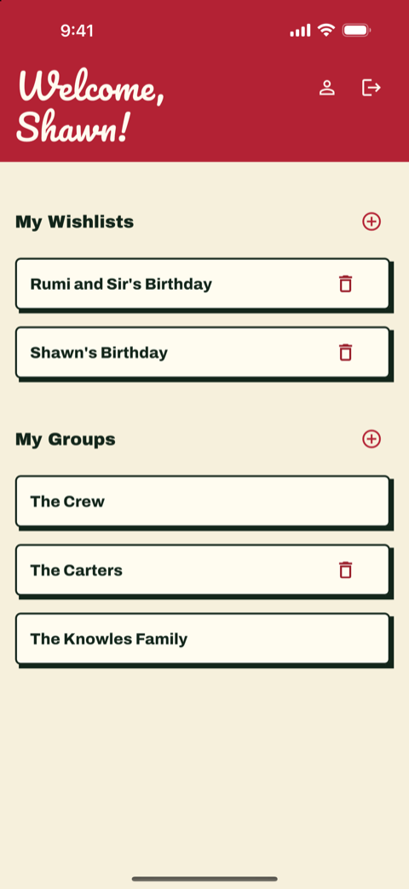
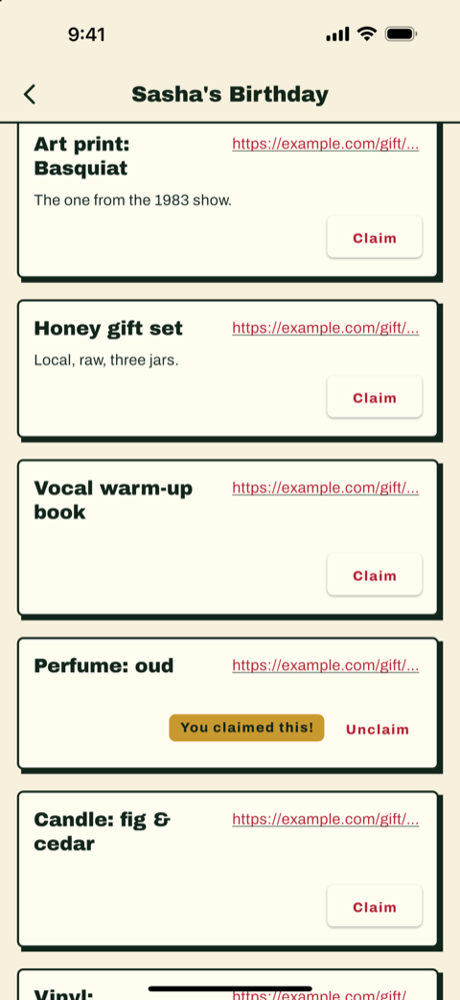
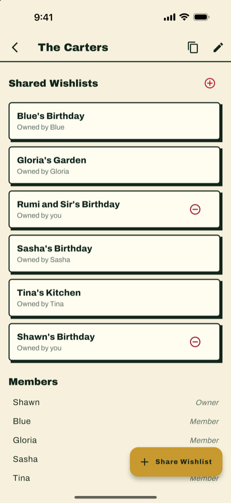

# WishTogether

Give the perfect gift every time!

## Try It Out

You can use the deployed version at [https://wishtogether.gift](https://wishtogether.gift)

## Screenshots

<table>
  <tr>
    <td></td>
    <td></td>
    <td></td>
  </tr>
  <tr>
    <td align="center">Your home</td>
    <td align="center">A shared wishlist</td>
    <td align="center">A group</td>
  </tr>
</table>

## Features

### Create Wishlists
Create and manage your personal wishlists. Add items you'd love to receive, and keep them organized.

### Share with Groups
Create groups with family and friends. Keep wishlists synced between multiple groups. Great for in-laws!

### Spoiler-Free Gifting
By default, no need to worry about spoilers! The owner can enable spoiler mode when they're ready to see what's been claimed.

## Development

WishTogether is a Flutter app. `AGENTS.md` is the rules and index for the repo; the topic docs under
`docs/` and `lib/**/docs/` carry architecture, CI, staging and authorization.

### Agent tooling

The repository carries the Agent Skills published by the Flutter and Firebase teams as git
submodules under `.agents/skills/`. A plain clone does not populate those directories, so
initialise them once per checkout, and add the same command to your agent environment's
workspace setup (Orca's per-repo setup hook, a Superset `.superset/config.json`, or your
own shell) — this repo does not configure one for you:

```bash
git submodule update --init
```

A fresh clone can use `git clone --recurse-submodules <url>` instead.
